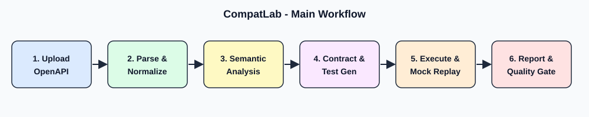

# CompatLab

**API Contract Verification & Compatibility Testing Platform**

Automated API compatibility analysis, semantic breaking-change detection, consumer-driven contract testing, test generation and CI/CD release quality enforcement.

   


## Why CompatLab?
Comparing two OpenAPI files line by line is not enough: changing a field from `integer` to `string` breaks consumers although the diff looks small. CompatLab classifies every change as **BREAKING**, **NON_BREAKING** or **CONDITIONAL**, separately for backward and forward compatibility, explains it, proposes a remediation and tells you which registered consumers are affected.

## Capabilities
- **Specification engine:** OpenAPI 3.x (JSON/YAML), internal `$ref` resolution, circular schemas, size and depth limits, deterministic normalization.
- **Semantic diff and rules:** 14 change types, 20 explainable rules, per-direction verdicts, CompatLab-defined scores that never hide a breaking change.
- **Consumer-driven contracts:** contract format, verification, consumer impact analysis.
- **Test generation and execution:** boundary, negative, authentication, status and schema tests; bounded, reproducible; run on a built-in mock or on explicitly allowed targets.
- **Mock, replay, workflows:** deterministic mock with request validation, masked recordings and replay, stateful workflows with retries, timeouts and cleanup.
- **Release gate:** policy-as-code, exit codes for CI (0 / 1 / 2 / 3), text, JSON and HTML reports.
- **Platform:** Gin REST API, PostgreSQL, authentication and tenant isolation, React dashboard, historical analytics.

## Quick start
```powershell
go mod tidy
./scripts/dev.ps1 fmt
./scripts/dev.ps1 check
go build -o bin/compatlab.exe ./apps/cli/cmd/compatlab
./bin/compatlab.exe gate --base testdata/compatible/users-v1.yaml --target testdata/breaking/users-v2-breaking.yaml --policy configs/release-policy.yaml --contract tests/fixtures/contracts/mobile-app.json
```
Full stack: `Copy-Item .env.example .env`, set the secrets, `cd apps/web; npm install`, then `docker compose up --build` (dashboard on http://127.0.0.1:8081). See [installation](docs/user-guide/installation.md).

## Architecture


Modular monolith: `internal/` engine packages, `apps/api` (REST), `apps/cli`, `apps/web`. Read [system overview](docs/architecture/system-overview.md), [component architecture](docs/architecture/component-architecture.md), [data flow](docs/architecture/data-flow.md) and the ADRs in [docs/design-decisions](docs/design-decisions).

## Tech stack
Go 1.22, Gin, pgx, PostgreSQL 16, React 18, TypeScript, Vite, Tailwind CSS, Recharts, Vitest, Playwright, Docker, GitHub Actions.

## Testing
```powershell
./scripts/dev.ps1 check            # Go: gofmt, vet, tests
cd apps/web; npm test              # dashboard unit tests
cd apps/web; npm run test:e2e      # browser end-to-end (needs Go and npm install)
go test ./benchmarks -run TestAccuracy -v
```
See the [test strategy](docs/testing/test-strategy.md).

## Benchmarks and evaluation
Results are produced by `./scripts/run-benchmarks.ps1` and stored with their environment in `docs/benchmarks/`. No figure is quoted in this README until a real run exists. Accuracy is measured against a small hand-labelled dataset ([method and caveats](docs/testing/accuracy-evaluation.md)).

## Evidence
Screenshots must come from real runs; see [docs/images/README.md](docs/images/README.md) and `./scripts/capture-evidence.ps1`.

## Limitations
See [docs/reports/limitations.md](docs/reports/limitations.md). In particular, this code base was written without a Go or Node toolchain: run the test suites first and fix anything they report.

## Documentation
[User guide](docs/user-guide) | [Developer guide](docs/developer-guide) | [Specifications](docs/specifications) | [Technical report](docs/reports/technical-report.md) | [CLI reference](docs/user-guide/cli-reference.md) | [REST API description](api/openapi/compatlab.yaml) | [Changelog](CHANGELOG.md) | [Security](SECURITY.md) | [Contributing](CONTRIBUTING.md)

## Roadmap
Pagination and mock/workflow pages in the dashboard, invitations and token refresh, nested-object test generation, more OpenAPI features, a larger labelled corpus.

## License
MIT - see [LICENSE](LICENSE).
