# CompatLab

### API Contract Verification & Compatibility Testing Platform

**CompatLab** is an API engineering platform for semantic OpenAPI compatibility analysis, consumer-driven contract verification, automated test generation, and release quality enforcement.

It helps engineering teams understand how API changes affect existing consumers, identify potentially breaking modifications, and evaluate API releases through explainable compatibility rules and automated verification.

<p align="center">
  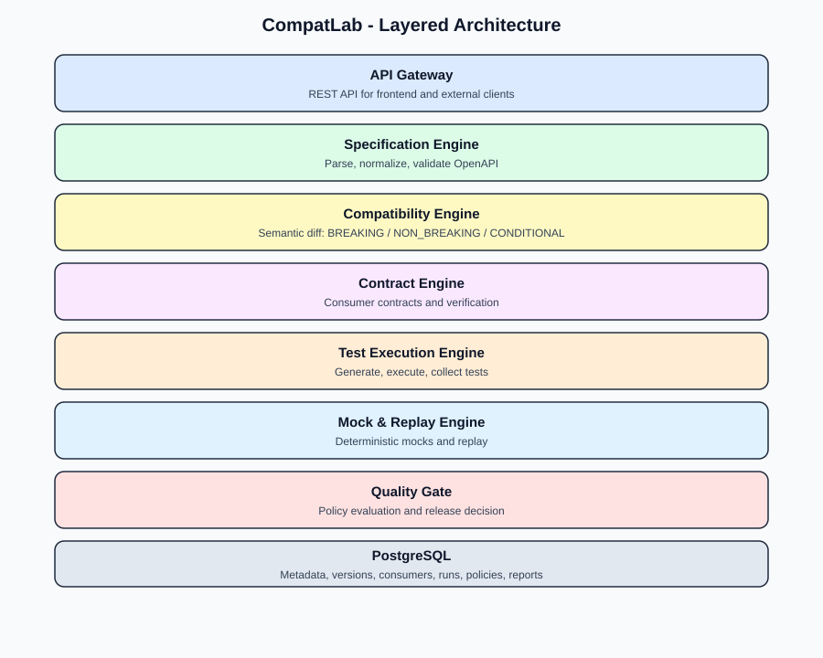
</p>

<p align="center">
  
  
  
  
  
</p>

---

## 1. Project Overview

API evolution introduces compatibility risks that are not always obvious from textual specification differences.

A field changing from `string` to `integer`, a newly required request parameter, or an additional authentication requirement can break existing consumers even when the underlying specification change appears small.

CompatLab addresses this problem through semantic API analysis.

Rather than relying exclusively on line-based comparisons, it evaluates API changes against compatibility rules, classifies their impact, and produces explainable results for both backward and forward compatibility.

### Key objectives

- Detect semantic API contract changes.
- Distinguish breaking, non-breaking, and conditional modifications.
- Explain compatibility decisions through identifiable rules.
- Verify registered consumer expectations against provider versions.
- Generate and execute bounded API test cases.
- Support policy-driven release decisions and machine-readable reports.

## 2. Key Capabilities

### OpenAPI Specification Engine

- OpenAPI 3.x JSON and YAML parsing.
- Internal `$ref` resolution.
- Circular schema handling.
- Specification size and depth limits.
- Deterministic specification normalization.
- Structured API and schema extraction.

### Semantic Compatibility Analysis

- 14 semantic change types.
- 20 explainable compatibility rules.
- Separate backward and forward compatibility analysis.
- Breaking, non-breaking, and conditional classifications.
- Severity-based change reporting.
- Rule identifiers and remediation guidance.
- Project-defined compatibility scoring.

**Compatibility scores are CompatLab-specific indicators, not industry-standard measurements.** Individual breaking changes remain explicitly visible rather than being concealed by an aggregate score.

### Consumer-Driven Contract Verification

- Consumer and provider contract definitions.
- Contract registration and validation.
- Verification against selected API versions.
- Response status and schema-field checks.
- Consumer impact analysis.

### Automated Test Generation and Execution

- Boundary-value test generation.
- Negative test cases.
- Authentication-related test cases.
- Response status and schema validation.
- Bounded and reproducible test execution.
- Mock-based and explicitly permitted target execution.

### Mocking, Replay and Workflows

- Deterministic API mocking.
- Request validation.
- Recording and replay support.
- Masking of recorded sensitive values.
- Stateful workflow execution.
- Retry, timeout and cleanup controls.

### Release Quality Enforcement

- Policy-as-code configuration.
- Compatibility and contract-based release evaluation.
- CLI-compatible exit codes.
- Text, JSON and HTML reporting.

### Engineering Dashboard

- API project and version management.
- Specification exploration.
- Compatibility analysis.
- Consumer contract management.
- Test execution visibility.
- Historical analytics.

---

## 3. Demonstration

The following screenshots are captured from the running CompatLab application and illustrate its implemented workflows.

### 3.1 API Version Management

Manage API specification versions within a project and compare different releases.

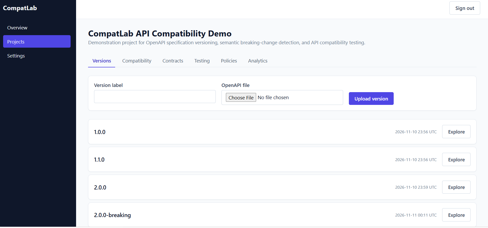

*Figure 1. API version management and specification history.*

### 3.2 OpenAPI Specification Exploration

Inspect specification metadata, endpoints, parameters, response definitions, security requirements, and schemas.

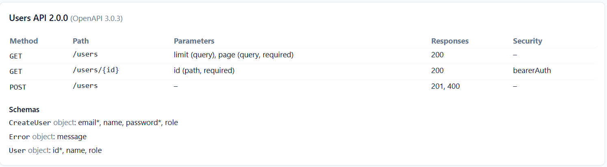

*Figure 2. OpenAPI specification exploration.*

### 3.3 Semantic Compatibility Analysis

Compare API versions and inspect compatibility classifications in both directions.

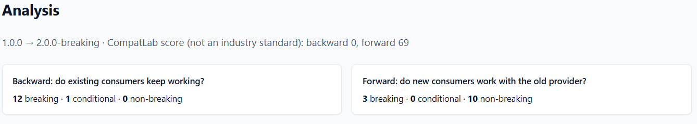

*Figure 3. Compatibility analysis overview, including backward and forward scores.*

The analysis interface provides detailed classifications and identifies changes that may affect existing consumers.

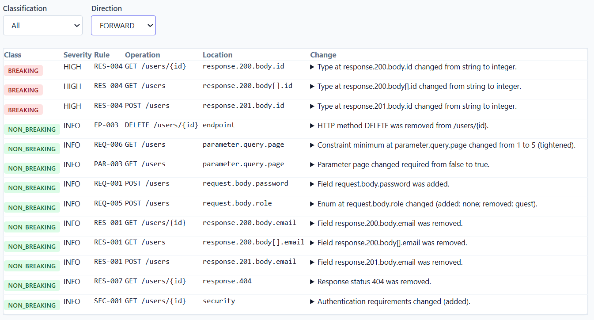

*Figure 4. Forward compatibility analysis.*

Response schema changes are also evaluated, including removed properties and incompatible type modifications.

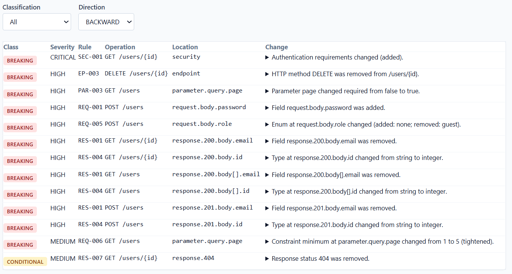

*Figure 5. Response schema compatibility findings.*

### 3.4 Consumer-Driven Contract Verification

Register consumer expectations and verify them against provider API versions.

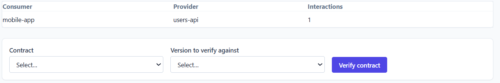

*Figure 6. Registered consumer contracts.*

The following example demonstrates a failed verification against a breaking API version.

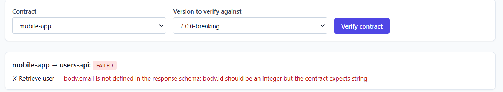

*Figure 7. Consumer contract verification identifying an incompatible API version.*

### 3.5 Automated Testing

The testing interface provides visibility into generated test suites and execution results.

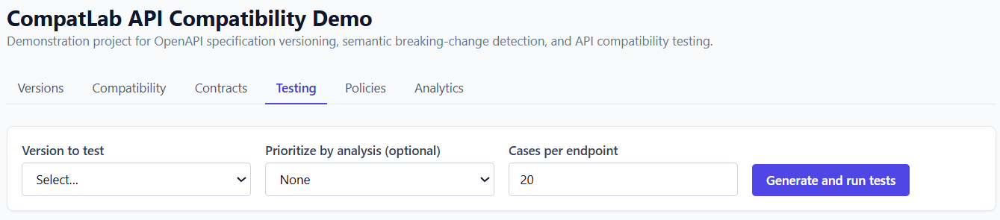

*Figure 8. Testing dashboard.*

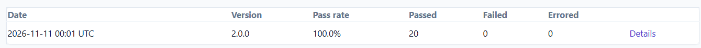

*Figure 9. Generated API test cases.*

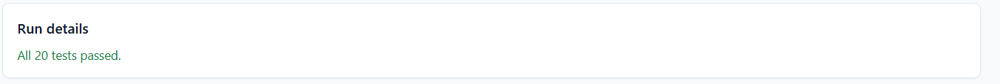

*Figure 10. API test execution results.*

### 3.6 Historical Analytics

Inspect historical analysis information through the analytics dashboard.

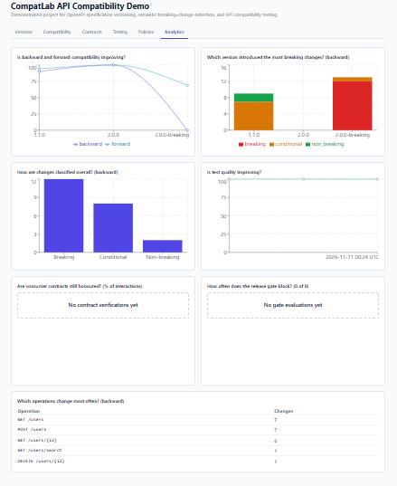

*Figure 11. CompatLab analytics interface.*

---

## 4. System Architecture

CompatLab follows a modular monolith architecture.

The core engineering capabilities are organized into independent internal packages, while the REST API, CLI, and web dashboard provide different interfaces to the same underlying platform.

### Architecture layers


### Processing workflow


### Module dependencies

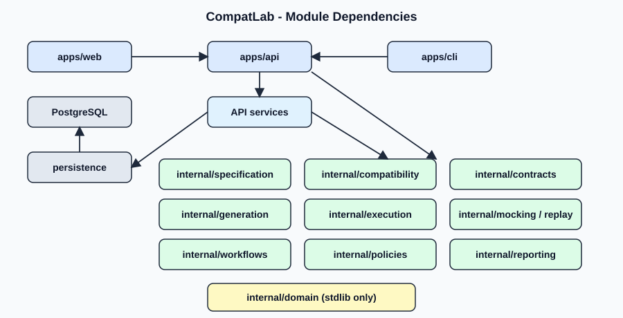

### Main components

| Component | Responsibility |
|---|---|
| Specification Engine | Parsing, validation and normalization of API specifications |
| Compatibility Engine | Semantic change detection and compatibility classification |
| Contract Engine | Consumer contract validation and verification |
| Test Generation | Generation of bounded API test cases |
| Execution Engine | Test execution and result collection |
| Mocking and Replay | Deterministic request simulation and replay |
| Workflow Engine | Stateful API workflow execution |
| Policy Engine | Release quality evaluation |
| Reporting | Structured compatibility and test reports |
| REST API | HTTP interface and application services |
| CLI | Command-line engineering workflows |
| Web Dashboard | Project, version and analysis visualization |
| Persistence | PostgreSQL-backed application data |

For further architectural details, see:

- [System Overview](docs/architecture/system-overview.md)
- [Component Architecture](docs/architecture/component-architecture.md)
- [Data Flow](docs/architecture/data-flow.md)
- [Module Dependencies](docs/images/module-dependencies.svg)
- [Architecture Decision Records](docs/design-decisions/)

---

## 5. Technology Stack

| Layer | Technologies |
|---|---|
| Core Engine | Go |
| REST API | Go, Gin |
| Database | PostgreSQL 16 |
| Database Access | pgx |
| Frontend | React, TypeScript |
| Build Tooling | Vite |
| Styling | Tailwind CSS |
| Data Visualization | Recharts |
| Frontend Testing | Vitest |
| Browser Testing Tooling | Playwright |
| Infrastructure | Docker, Docker Compose |
| CI/CD | GitHub Actions |
| API Specification | OpenAPI 3.x |

---

## 6. Repository Structure

```text
compatlab/
├── apps/
│   ├── api/                 # REST API application
│   ├── cli/                 # Command-line interface
│   └── web/                 # React and TypeScript dashboard
│
├── internal/
│   ├── analytics/
│   ├── auth/
│   ├── compatibility/
│   ├── contracts/
│   ├── execution/
│   ├── generation/
│   ├── mocking/
│   ├── persistence/
│   ├── policies/
│   ├── replay/
│   ├── reporting/
│   ├── security/
│   ├── service/
│   ├── specification/
│   ├── validation/
│   └── workflows/
│
├── configs/                 # Application and policy configuration
├── deployments/             # Docker and deployment configuration
├── docs/
│   ├── architecture/
│   ├── benchmarks/
│   ├── design-decisions/
│   ├── developer-guide/
│   ├── images/
│   ├── reports/
│   ├── specifications/
│   ├── testing/
│   └── user-guide/
│
├── scripts/                 # Development and verification scripts
├── testdata/                # OpenAPI and compatibility fixtures
├── tests/                   # Integration and other test fixtures
│
├── api/
│   └── openapi/
│
├── docker-compose.yml
├── go.mod
├── go.sum
├── CHANGELOG.md
├── CONTRIBUTING.md
├── LICENSE
└── README.md
```

---

## 7. Getting Started

### Prerequisites

- Go 1.25 or later.
- Node.js version compatible with the frontend project.
- npm.
- Docker Desktop with Docker Compose.
- Git for cloning the repository.

### 7.1 Clone the repository

```bash
git clone https://github.com/YOUR_USERNAME/compatlab.git
cd compatlab
```

Replace `YOUR_USERNAME` with the actual GitHub account name after publication.

### 7.2 Verify the Go environment

```bash
go version
go mod download
```

### 7.3 Run development checks

From the project root:

```powershell
./scripts/dev.ps1 fmt
./scripts/dev.ps1 check
```

### 7.4 Build the CLI

```powershell
New-Item -ItemType Directory -Force .\bin | Out-Null

go build -o .\bin\compatlab.exe ./apps/cli/cmd/compatlab

.\bin\compatlab.exe --help
```

### 7.5 Configure the application

Create a local environment file:

```powershell
Copy-Item .env.example .env
```

Configure the required database and authentication secrets in `.env` before starting the application.

Do not commit `.env` or production credentials.

### 7.6 Start the full application

From the repository root:

```powershell
docker compose up --build -d
```

Check container health:

```powershell
docker compose ps
```

Access the local dashboard:

**http://127.0.0.1:8081**

Stop the application:

```powershell
docker compose down
```

To stop the application and preserve the database volume, do not add `-v`.

---

## 8. Command-Line Interface

CompatLab provides a CLI for specification analysis and API engineering workflows.

Available command groups include:

| Command | Purpose |
|---|---|
| `spec` | Specification operations |
| `diff` | API version comparison |
| `analyze` | Compatibility analysis |
| `contract` | Consumer contract operations |
| `test` | Test generation and execution |
| `mock` | Mock API operations |
| `workflow` | Workflow execution |
| `gate` | Policy-based release evaluation |

Inspect available commands:

```powershell
.\bin\compatlab.exe --help
```

Example compatibility release evaluation:

```powershell
.\bin\compatlab.exe gate `
  --base testdata/compatible/users-v1.yaml `
  --target testdata/breaking/users-v2-breaking.yaml `
  --policy configs/release-policy.yaml `
  --contract tests/fixtures/contracts/mobile-app.json
```

The example uses repository fixtures and the supplied policy configuration. Actual output depends on the selected fixtures and policy.

---

## 9. Testing and Verification

CompatLab includes Go package tests, frontend unit tests, build checks, and integration-oriented test packages.

### Go verification

```powershell
go test ./...
go vet ./...
go build ./...
```

Alternatively, use the repository development check:

```powershell
./scripts/dev.ps1 check
```

### Frontend unit tests

```powershell
cd apps/web
npm install
npm test
npm run build
```

Return to the repository root before running Go commands.

### Test fixtures

The repository includes example specifications for:

- Valid API definitions.
- Compatible API evolution.
- Breaking API changes.
- Conditional compatibility changes.
- Invalid specification handling.
- Accuracy evaluation.
- Workflow scenarios.
- Consumer contract verification.

See [Testing Strategy](docs/testing/test-strategy.md).

---

## 10. Evaluation and Benchmarks

CompatLab separates functional correctness testing from performance and accuracy evaluation.

### Evaluation dimensions

- Semantic change classification.
- Backward compatibility detection.
- Forward compatibility detection.
- Consumer contract verification.
- Test generation and execution behavior.
- Processing performance.
- Reproducibility of results.

Benchmark results should be interpreted alongside their execution environment, dataset characteristics, and experimental configuration.

See:

- [Benchmark documentation](docs/benchmarks/)
- [Accuracy evaluation methodology](docs/testing/accuracy-evaluation.md)

No performance or accuracy figure is presented here without a corresponding reproducible experiment and recorded result.

---

## 11. Security Considerations

API analysis and execution require careful handling of potentially untrusted specifications and request targets.

Important security considerations include:

- Authentication and authorization.
- Organization-level data isolation.
- Input validation and bounded specification processing.
- Restrictions on external API execution.
- Request timeouts and resource limits.
- Sensitive-value masking in recordings.
- Secure handling of environment variables and credentials.

Only execute requests against targets that are explicitly authorized.

See [Security Policy](SECURITY.md).

---

## 12. Design Decisions

CompatLab documents important architectural and implementation choices through Architecture Decision Records (ADRs).

These decisions provide context for the platform's design, trade-offs, and implementation boundaries.

See [Architecture Decision Records](docs/design-decisions/).

---

## 13. Current Scope and Future Development

Potential future improvements include:

- Expanded dashboard functionality for mock, replay and workflow operations.
- Additional OpenAPI feature coverage.
- More extensive consumer contract scenarios.
- Larger independently labelled compatibility datasets.
- Expanded performance evaluation.
- Additional dashboard and end-to-end testing coverage.

These areas represent opportunities for continued development rather than claims of completed functionality.

---

## 14. Documentation

| Resource | Description |
|---|---|
| [User Guide](docs/user-guide/) | Application usage |
| [Developer Guide](docs/developer-guide/) | Development and implementation |
| [Architecture](docs/architecture/) | System design and components |
| [Specifications](docs/specifications/) | Technical specifications |
| [Testing Strategy](docs/testing/test-strategy.md) | Testing approach |
| [Technical Report](docs/reports/technical-report.md) | Project methodology and findings |
| [CLI Reference](docs/user-guide/cli-reference.md) | CLI commands |
| [OpenAPI Definition](api/openapi/compatlab.yaml) | REST API specification |
| [Changelog](CHANGELOG.md) | Project changes |
| [Contributing](CONTRIBUTING.md) | Contribution guidance |
| [Security](SECURITY.md) | Security reporting and considerations |

---

## 15. License

This project is distributed under the MIT License. See [LICENSE](LICENSE) for details.
