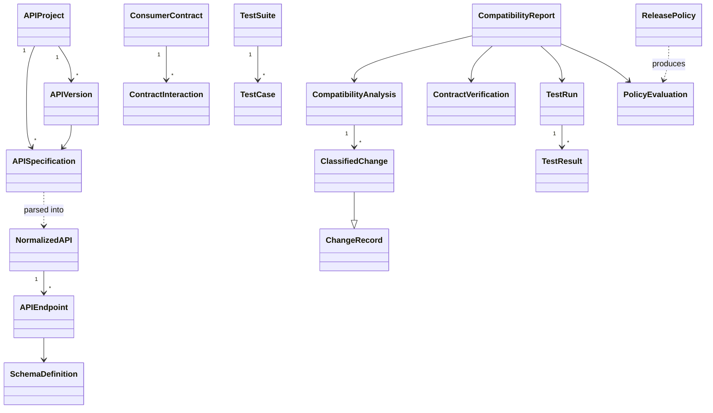

# Domain Model

All entities live in `internal/domain` and depend only on the Go standard library (enforced by `boundaries_test.go`).

## Enumerations
`ChangeClassification` (BREAKING, NON_BREAKING, CONDITIONAL), `Severity`, `CompatibilityDirection` (BACKWARD, FORWARD), `ChangeType` (12 types), `TestStatus`, `TestCategory`, `PolicyDecision` (PASS, WARN, BLOCK), `SpecificationStatus`.

## Key decisions
- `NormalizedAPI.Normalize()` sorts all order-insensitive collections, which makes analysis independent of source layout.
- `CanonicalPath` compares routes by structure (`/users/{id}` equals `/users/{userId}`).
- `ChangeRecord.ID` is a hash of the change coordinates, so IDs are stable across runs.
- `CompatibilityAnalysis` carries no timestamps, so equal inputs give equal output.
