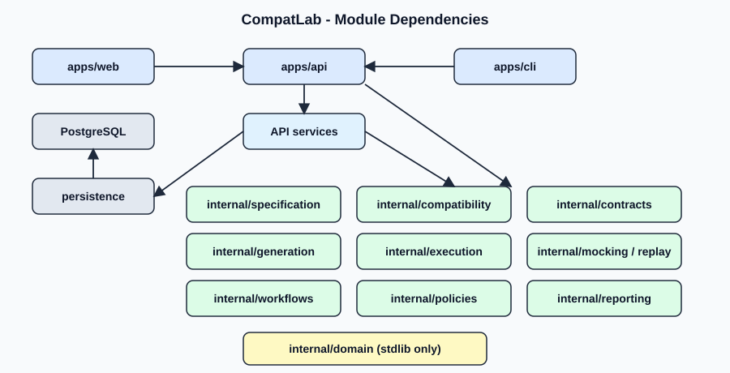

# Module Dependencies

Rules:
- `internal/domain` imports nothing outside the standard library.
- Engine packages import `domain` and, where needed, each other in the direction shown; never `apps/*` or `persistence`.
- Only backend services import `internal/persistence`.
- `apps/web` talks to `apps/api` over HTTP only.
