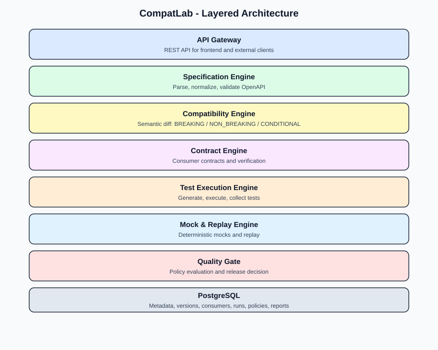

# System Overview

CompatLab is a **modular monolith** (see [ADR-0001](../design-decisions/ADR-0001-modular-monolith.md)): one Go module at the repository root, a separate React frontend and PostgreSQL for persistence. The core engine runs without PostgreSQL, HTTP or the frontend.

## Design principles
1. The Core Engine is independent of the frontend and the database.
2. Analysis is deterministic: equal inputs give byte-identical results.
3. Classification uses context and compatibility direction, never field names alone.
4. Every compatibility rule has a test.
5. Benchmark numbers come from real runs only.
6. The dashboard shows only data returned by the backend.
7. The test engine only contacts explicitly allowed targets, and runs on a mock by default ([ADR-0004](../design-decisions/ADR-0004-test-execution-isolation.md)).

See [component architecture](component-architecture.md), [data flow](data-flow.md), [domain model](domain-model.md) and [module dependencies](module-dependencies.md).
